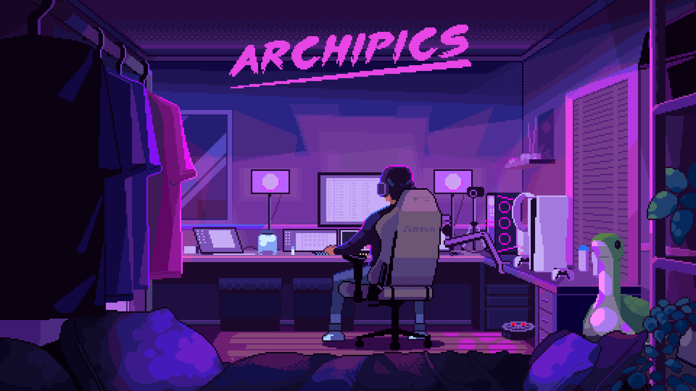

  

<h1 align="center">
  
</h1>

  
  
  

---

## 🚀 About Me

🎓 Final-year **Computer Science Engineering Student**
🧠 **AI Researcher | Full Stack Developer | Problem Solver**

* 📈 Increased platform engagement by **60%**
* ⚡ Delivered scalable systems across **Tripura & Assam regions**
* 🧪 Published research in **Springer (ICT4SD 2025)**
* 🔥 1700+ GitHub contributions in last year

---

## 🌐 Connect With Me

  
  
  
  

---

## 🧠 Tech Stack

 

   
   

---

## 💼 Experience

### 🏢 Software Developer — Maruti Suzuki India Limited

📅 Apr 2025 – Present

* Managed **high-availability SQL Server systems**
* Optimized performance across **regional operations**
* Integrated distributed systems using **VB.NET + SQL Server**

---

### 🚀 Chief Technology Officer — Apni Estate & Apni Vidya

📅 Nov 2022 – May 2025

* 📈 Boosted user engagement by **60%**
* ⚙️ Delivered scalable platforms with **35% higher success rate**
* 👨‍💻 Led full-stack development & cross-functional teams

---

## 🧪 Research & Publications

### 📄 FBCA-IoMT Framework (Springer, ICT4SD 2025)

* 🔬 Federated Learning + Contrastive Autoencoder
* 🏥 Focus: IoMT anomaly detection
* 🔐 Privacy-preserving AI system
* 📊 Validated on medical + IoT datasets

🔗 View on Google Scholar:
https://scholar.google.com/citations?user=ArGuUjgAAAAJ&hl=en

---

## 🚀 Featured Projects

### 🧭 COMPASS — Smart Tourist Planner

* Full-stack app using **React + Golang + MongoDB**
* Govt. of Tripura sponsored project

---

### 🤖 IGRIS — AI Decision-Making System

* Built with **PyQt5, threading, dotenv**
* Intelligent decision modeling system

---

### 🏥 Care Plus — Healthcare Platform

* Doctor appointment system
* Stack: **React + Node.js + MongoDB**

---

## 🏆 Achievements

* 🥈 Runner-Up — Arjuna 1.0 Hackathon (NIT Agartala)
* 🥇 1st Place — App & Web Dev (TechNOVATE 2025)
* 🥈 2nd Place — DevOps (TechNOVATE 2025)
* 🌍 AI Project showcased at:

  * IIT Guwahati (BRICS)
  * NIT Agartala
  * ICFAI University Tripura

---

## 📊 GitHub Stats

  

---

## 🎯 Current Focus

* 🧠 Advanced AI Systems & Generative AI
* ⚡ Scalable Full Stack Architectures
* 🔐 Cybersecurity + Secure Systems
* 📈 Data-driven Product Development

---

  

